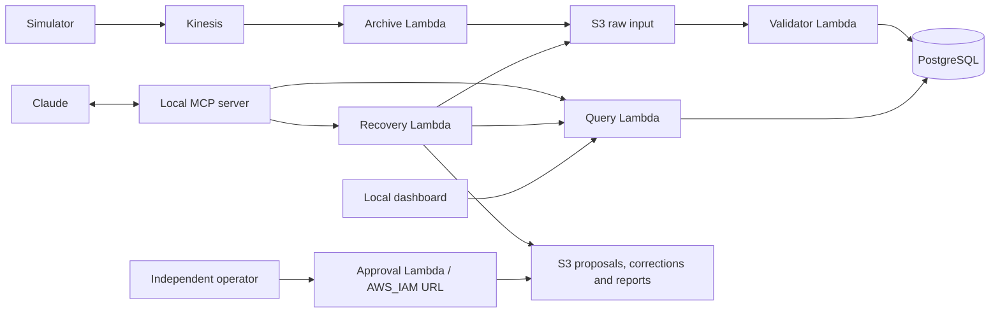

# Device Investigation and Recovery with MCP

A Ring-inspired data engineering prototype that lets an AI assistant investigate synthetic device
telemetry and recover rejected events through a separately authenticated human approval workflow.
It is not connected to real Ring devices or the Ring app.

## What it demonstrates

- Event ingestion through Kinesis, an archive Lambda, S3, a validator and PostgreSQL.
- 17 MCP tools, three resources and one investigation prompt exposed over stdio to Claude.
- Rejection inspection, correction preview, immutable proposal, operator approval, correction
  artifact, replay, ingestion verification and a scoped audit history.
- Device health, daily metrics, consistency checks, and saved S3 reports.
- A bounded streaming simulator, a local read-only dashboard and ten CloudWatch alarms.

The agreed functional prototype was demonstrated on 2026-09-21. A controlled missing-source failure
produced a Lambda error metric and an actual alarm transition. The final live smoke verified discovery,
resources, the prompt and three read operations. Other recovery and simulator checks were exercised
earlier. See [verification scope](docs/project/checklist.md) for what has and has not been tested.

## Architecture



## Repository layout

```text
ring-device-investigation/
  services/
    mcp/                    # MCP implementation and resource documents
    lambdas/                # query, validator, recovery, approval source
  apps/dashboard/           # Local Python server and browser assets
  tools/
    simulator/              # Bounded synthetic event producer
    operator/               # Independent human approval client
    diagnostics/            # Read-only troubleshooting utilities
  infra/
    database/               # PostgreSQL schema and verification SQL
    iam/                    # Scoped policy documents
    monitoring/             # CloudWatch alarm stack generator and deployment
  tests/
    unit/                   # Mocked component tests
    protocol/               # Real local MCP protocol checks
    integration/            # Explicit, live AWS checks
  config/                   # Shareable configuration examples
  examples/                 # Synthetic inputs and earlier SQLite demo
  scripts/                  # Offline verification and publication checks
  docs/                     # Architecture, runbooks, reference and interview guide
  .github/                  # Offline CI workflow and PR template
  aws_mcp_server.py         # Compatibility entry point for existing Claude setup
  approval_client.py        # Compatibility entry point for operator commands
  local-only/              # IGNORED: PDFs, old versions, logs and private config
```

## Quick start without AWS

Python 3.11 is used for local development. Run these commands from the repository root:

```powershell
python -m venv .venv-aws
.\.venv-aws\Scripts\python.exe -m pip install -r requirements.txt
.\.venv-aws\Scripts\python.exe scripts/test_offline.py
.\.venv-aws\Scripts\python.exe apps/dashboard/dashboard.py --demo
```

Open `http://127.0.0.1:8765/`. Demo mode is visibly labelled sample data. Stop with Ctrl+C.
Preview producer data without sending it:

```powershell
.\.venv-aws\Scripts\python.exe tools/simulator/stream_simulator.py
```

On macOS/Linux, use `.venv-aws/bin/python` instead. Do not recreate your existing environment just
because the repository was reorganized.

## Use the existing AWS deployment

Use `ring-mcp` for query/recovery, `ring-dev` for event production and `ring-operator` for approvals.
Renew the relevant login and verify its identity before live use. With AWS configured:

```powershell
.\.venv-aws\Scripts\python.exe tests/integration/test_aws_mcp_readiness.py
.\.venv-aws\Scripts\python.exe apps/dashboard/dashboard.py
```

The producer only writes when `--send` is supplied; its default run lasts three minutes. The
pipeline reacts automatically to arriving data. There is no always-on producer or scheduled
customer notification system. The dashboard and MCP client use local AWS profiles, not browser credentials.

Copy the paths in [Claude configuration](config/claude_desktop_config.example.json) to your host's
configuration. The root MCP launcher is preserved so the existing setup need not change.

## Documentation

- [Architecture](docs/architecture/overview.md) and [database](docs/architecture/database.md)
- [MCP catalog](docs/reference/mcp-catalog.md)
- [Local development](docs/runbooks/local-development.md)
- [AWS deployment boundaries](docs/runbooks/deployment.md)
- [Monitoring runbook](docs/runbooks/monitoring.md)
- [Interview guide](docs/interview/guide.md)
- [Current status](docs/project/status.md) and [verification checklist](docs/project/checklist.md)
- [Repository reorganization](docs/project/repository-layout.md)

## Important limits

This is a tested prototype, not a production service. Historical queries use currently stored data
filtered by event time, so late arrivals and approved replays may affect old dates. Missing heartbeats
mean suspected offline, not confirmed hardware failure. Idempotency is demonstrated for specific
requests; exactly-once transport is not claimed. S3 and PostgreSQL do not share one transaction.

AWS identifiers are deployment-specific, and the archive Lambda's current source has not yet been
exported here. This repository is not a complete one-command deployment of the original AWS account.
The earlier SQLite Docker example is under `examples/local_demo/`.

See [contribution instructions](CONTRIBUTING.md) and [security notes](SECURITY.md) before publishing.
Learning PDFs, account evidence and historical drafts stay in the Git-ignored `local-only/` folder.
GitHub Actions runs offline tests only; a Git push does not deploy AWS.
