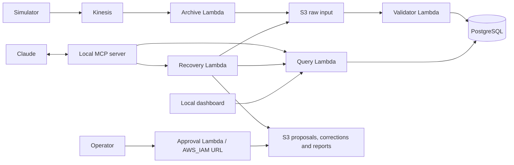

# Device Investigation and Recovery with MCP

Investigate missing device telemetry, trace rejected events, and replay approved corrections
through Claude. The pipeline processes synthetic heartbeat data on AWS; a local MCP server
provides scoped access to the evidence and recovery operations.

## Features

- Event ingestion through Kinesis, Lambda, S3, and PostgreSQL.
- 17 MCP tools, three resources, and a reusable investigation prompt for Claude.
- Device health, event history, daily metrics, and ingestion consistency checks.
- Correction previews, saved proposals, independent operator approval, and verified replay.
- A local dashboard, bounded streaming simulator, and CloudWatch alarms.

## Architecture



Claude selects tools and summarizes their results. Backend validation and IAM enforce access.
Recovery requires approval of the exact proposal by a separate operator. A saved correction
does not change the database: replay submits input through the validator, and ingestion is
verified separately. Original rejection records remain available.

## Run locally

Requires Python 3.11. From the repository root:

```powershell
python -m venv .venv-aws
.\.venv-aws\Scripts\python.exe -m pip install -r requirements.txt
.\.venv-aws\Scripts\python.exe scripts/test_offline.py
.\.venv-aws\Scripts\python.exe apps/dashboard/dashboard.py --demo
```

Open http://127.0.0.1:8765/ for the dashboard with sample data. Stop it with Ctrl+C.
On macOS/Linux, use `.venv-aws/bin/python` instead.

Preview synthetic events without AWS access:

```powershell
.\.venv-aws\Scripts\python.exe tools/simulator/stream_simulator.py
```

## Connect to AWS and Claude

Configure AWS profiles for the deployed environment: `ring-mcp` for investigation and recovery,
`ring-dev` for the producer, and `ring-operator` for independent approval. Configure Claude using
[the example configuration](config/claude_desktop_config.example.json), replacing its paths
with absolute paths to your Python interpreter and MCP server.

```powershell
.\.venv-aws\Scripts\python.exe tests/integration/test_aws_mcp_readiness.py
.\.venv-aws\Scripts\python.exe apps/dashboard/dashboard.py
```

The simulator sends events only with `--send` and stops after three minutes by default.
Downstream ingestion runs automatically when input arrives.

The repository includes four Lambda implementations, IAM policies, a database schema, and
monitoring deployment tooling. The archive Lambda source and complete infrastructure provisioning
are not included. Follow the [deployment guide](docs/runbooks/deployment.md) before using a new
AWS account; resource and identity bindings must be configured consistently.

## Repository structure

```text
services/mcp/        MCP server, resources, and prompt
services/lambdas/    Query, validator, recovery, and approval functions
apps/dashboard/     Local web dashboard
tools/              Simulator, operator client, and diagnostics
infra/              Database schema, SQL queries, IAM policies, and monitoring
tests/              Unit, MCP protocol, and AWS integration tests
config/             Configuration examples
examples/events/    Synthetic input fixtures
scripts/            Offline test runner and publication checks
docs/               Architecture, reference, and operating instructions
```

The root `aws_mcp_server.py` and `approval_client.py` are entry points for the implementations
under `services/` and `tools/`.

## Documentation

- [Architecture](docs/architecture/overview.md) and [database schema](docs/architecture/database.md)
- [MCP tools, resources, and prompt](docs/reference/mcp-catalog.md)
- [Local setup](docs/runbooks/local-development.md) and [AWS deployment](docs/runbooks/deployment.md)
- [Dashboard](docs/runbooks/dashboard.md), [simulator](docs/runbooks/simulator.md), and [monitoring](docs/runbooks/monitoring.md)
- [Testing](tests/README.md), [contributing](CONTRIBUTING.md), and [security](SECURITY.md)

## Scope

This project uses synthetic telemetry and has no connection to Ring devices or the Ring app.
Missing heartbeats indicate suspected inactivity, not confirmed hardware failure. Historical
queries include currently stored late arrivals and replays. S3 and PostgreSQL do not share a
transaction, and transport is not exactly-once. The dashboard runs locally; it is not a public,
multi-user service.

GitHub Actions runs offline tests. Pushing code does not deploy AWS resources.
