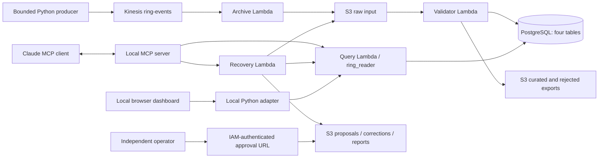

# Architecture and design

Synthetic, single-household demonstration in AWS us-east-1, account 455646290306. This is not an official Ring integration.

The query and validator reach private RDS over configured VPC networking. IAM controls AWS API permissions; PostgreSQL users control SQL privileges; networking controls reachability. These are separate requirements. Recovery delegates database reads to the query Lambda and writes S3 artifacts. It does not directly update accepted PostgreSQL rows.

MCP uses stdio between the host client and local server. boto3 invokes fixed AWS functions. The host model chooses tools; the MCP server and AWS functions constrain inputs and enforce permissions. The dashboard reuses invoke_query without speaking MCP.

The five Lambdas separate archive, ingestion, read queries, recovery and human approval. Event-driven triggers automate downstream ingestion when input arrives. The simulator itself is bounded and manually started. A stopped producer is not an infrastructure failure, and an idle alarm is not proof of complete delivery.

Four tables retain registration, ingestion attempts, accepted events and rejection occurrences. Rejections are scoped through their ingestion run. Duplicate delivery can increase run counters without adding accepted events. Event time describes the synthetic observation; received_at records database arrival. Current snapshots can include late arrivals and replayed corrections.

Recovery sequence: inspect -> correction preview -> persisted proposal -> replay prediction -> independent approval -> correction artifact -> replay input -> validator -> observe ingestion -> verify row and original rejection. Approval and proposal are separate documents so the reviewed proposal remains unchanged. Read status is not authorization; writes validate evidence and expiry themselves.

Tradeoffs: S3 preserves input and makes recovery inspectable, but adds latency and many small objects. PostgreSQL offers constraints and joins, but requires connections and VPC operations. Several Lambdas simplify permission boundaries but add deployment steps. Exactly-once event transport is not claimed; stable IDs, digests, database uniqueness and fixed conditional S3 keys make specific retries safe. S3 exports and PostgreSQL are not one atomic transaction.

Current source locations are mapped in docs/interview/guide.md. Older aws/query_lambda.py and PDF trackers are historical, not the latest deployment reference.
